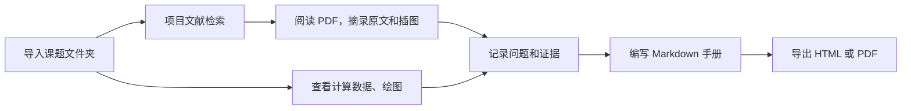
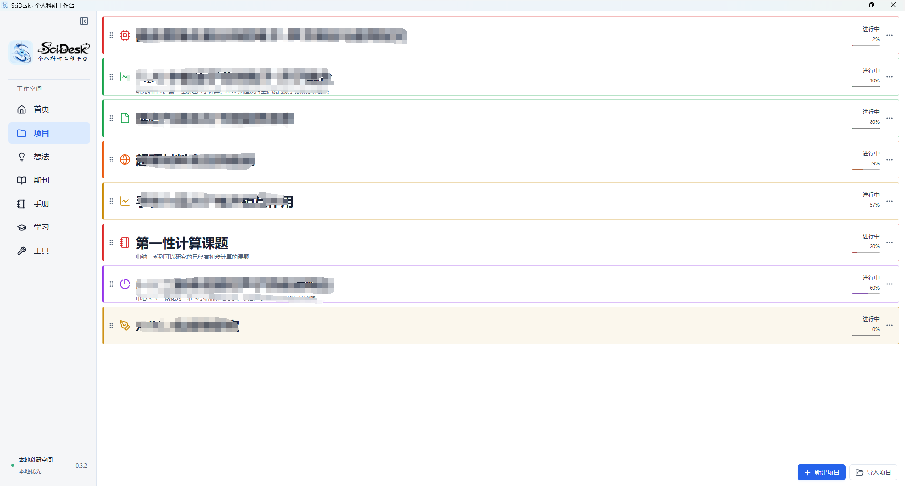
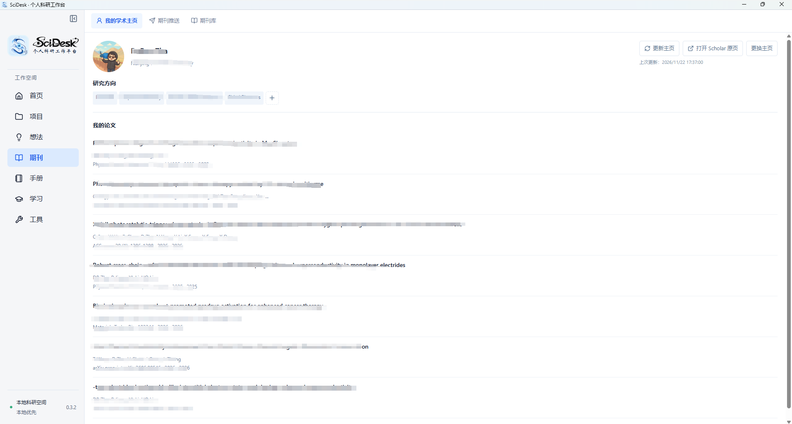
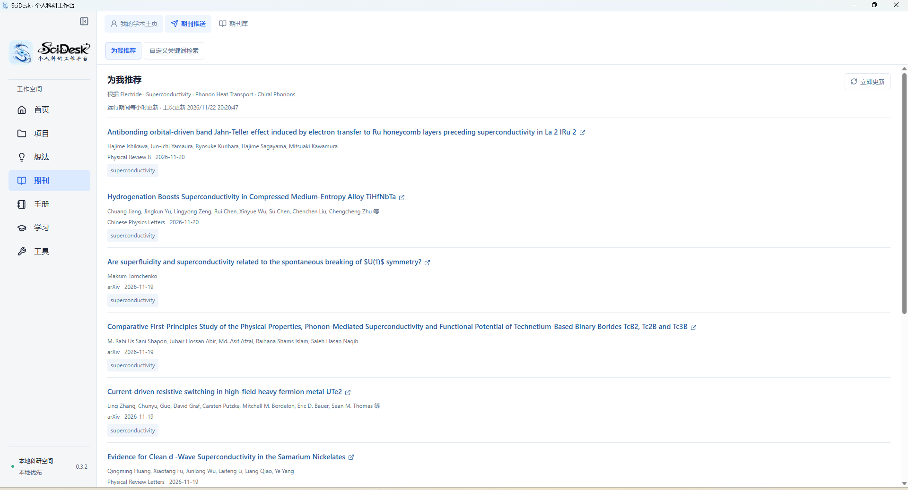
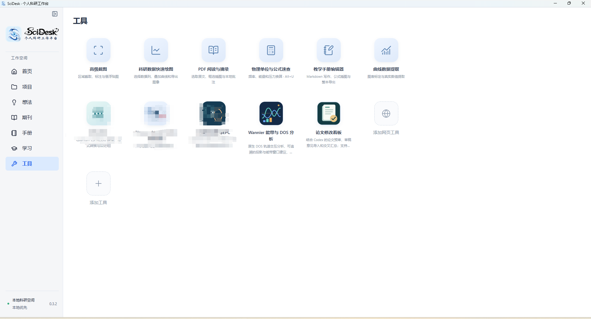

# SciDesk · 个人科研工作台

SciDesk 是一款中文 Windows 桌面软件，把课题文件、论文线索、计算结果和教学笔记放在同一个工作界面中。你可以从磁盘上已有的课题目录开始，查阅相关文献、摘录论文中的图和文字，再把自己的计算步骤整理成一份可以分享的手册。

工具区也可以纳入自己的常用程序：将经常使用的代码做成独立界面，再接入 SciDesk，便于从同一个工作台打开。

**当前正式版：0.4.5 Ai，适用于 Windows 10/11 x64。** [下载安装包](https://github.com/superbao512-sudo/SciDesk/releases/download/v0.4.5/SciDesk_0.4.5_x64-setup.exe) · [SHA-256 校验文件](https://github.com/superbao512-sudo/SciDesk/releases/download/v0.4.5/SHA256SUMS.txt) · [发布说明](https://github.com/superbao512-sudo/SciDesk/releases/tag/v0.4.5)

[安装与旧版升级说明](docs/windows-install-upgrade.md) · [相较于 0.3.2 的更新内容](CHANGELOG.md)

**双击安装器即可安装或升级。** 安装名称始终为 **SciDesk**，版本更新不改变名称。公共安装包仅包含程序、内置离线模型和必需资源，不包含开发者的测试项目、聊天、个人数据库、模型配置或 API 密钥。

## 0.4.5 Ai 有什么变化

| 变化 | 日常使用 |
| --- | --- |
| 统一的 SciDesk Ai | 普通聊天与通用 Agent 合并，可创建 AI 项目，在项目中组织会话；文献检索保留独立工作区。 |
| 通过对话完成多步文件任务 | 在授权目录创建文件夹、写文本、复制、移动、重命名和移入回收站；危险操作先展示具体目标并确认。 |
| 更少的不必要模型调用 | 明确的目录列名可直接使用本地工具；任务状态和模型返回的 token 用量可以查看。 |
| 首次即可离线翻译 | PDF 英译中权重随程序内嵌，空缓存不需要下载模型，仍可自选联网 API。 |
| 近期文献与摘要 | 按最近 1、7、14、30 或 90 天推荐，标题展开来源摘要，识别 arXiv 来源。 |
| 学习和手册更易整理 | 批量移除学习资源、删除分类；手册名称与草稿同步，增加常用工具栏、章节大纲和保存状态。 |

完整变化和能力边界见 [更新记录](CHANGELOG.md)。

本次安装包已在 Windows 11 的独立临时标准账户中验证图形安装、启动与重启，以及从正式 0.3.2 安装器升级后保留合成用户数据。测试使用已有 WebView2；其他 Windows 版本和缺少 WebView2 时的联网安装未在本轮验证。详见 [安装验收范围](docs/windows-install-upgrade.md#本次安装验收范围)。

## 第一次打开

双击发布页中的安装包，按中文向导选择当前账户可写的目录。若电脑缺少 Microsoft Edge WebView2，安装时需要联网。启动后选 **项目 → 导入项目**，指向你平时使用的课题文件夹，即可从文件树打开已有资料。首页支持按 **Ctrl+K** 搜索，也可以点击首页副标题或问候语旁的编辑按钮，写下自己的工作提醒。

## 从一个课题开始

下方截图沿用已有版本的布局示例；0.4.5 的按钮、名称和新增功能以实际界面及本页说明为准。

以「某种材料的物性」为例，原始计算放在项目文件夹里，研究假设放在想法画布上，值得复用的步骤写进手册。下面是一条可按需要选用的工作路线。

### 项目、文献检索与想法

| 工作 | 入口与操作 | 得到什么 |
| --- | --- | --- |
| 管理课题文件 | 在「项目」中新建或导入目录。进入文件树后，右击文件或文件夹可复制、重命名，或经确认后移入回收站。 | 整理结果直接反映在磁盘上。试算新参数时，可以先复制一份输入文件。 |
| 检索课题文献 | 在项目文件页点「项目文献检索」，输入材料名和关键词，例如 `phonon scattering`，按期刊、arXiv 来源和年份筛选。 | 打开原始记录核对作者和 DOI，导出 Markdown 阅读清单或 JSON 结果。 |
| 记录研究思路 | 在「想法」中按主题建立房间，在画布上添加节点、附件和连线。 | 例如把「低频模贡献是否下降」连到待检验的假设、对应图表和下一步计算，之后可以回到同一张画布继续。 |

### 期刊：跟踪自己的研究方向

1. **连接学术主页。** 在「我的学术主页」填入自己的 Google Scholar 作者主页链接，核对研究方向和论文列表。若连接失败，可在浏览器展开希望导入的论文，右击网页空白处选「另存为…」，保存为 HTML，再到「更换主页 → 导入主页 HTML」选择主文件。
2. **看近期推荐。** 「为我推荐」根据主页研究方向获取最近文献。在「立即更新」左侧的「设置」中选择最近 1、7、14、30 或 90 天，区间包含当天并每日前移。点击标题展开来源摘要，单独的原文链接打开论文页面；不生成缺失摘要，也不需要在推荐页设置 AI。获取新文章需要网络。
3. **查临时主题。** 「自定义关键词检索」适合单独查一个材料或方法，例如 `chiral phonons`。如果关心特定刊物，可到「期刊库」浏览和管理来源，再打开原文。

### 学习：把自己的书签变成分类目录

从 Chrome 书签管理器或 Edge 收藏夹菜单导出书签 HTML，然后打开 **学习 → 导入自己的浏览器书签（HTML）**。原文件夹已经分好类时，可直接选择文件；需要整理时，展开页面内的 AI 分类提示词，将提示词和准备分享的书签交给自己选择的 AI，再导入它返回的书签 HTML。

SciDesk 会先列出识别出的分类和网址数量，确认后才写入学习库，重复网址会跳过。例如，可以把 **Quantum ESPRESSO → 官方文档、入门教程、计算实例** 放在同一主题下，另建 **声子与热输运** 保存相关资料。也可以单独添加网址、编辑分类，或给某条资源关联一份本地备份。

批量整理时点击「批量管理」，选择资源后确认移除；分类管理中可删除大类，并选择保留其资源或一并移除记录。两种方式都不会删除原始本地文件。

### 手册：从本地文件夹到可分享的教程

「手册」可以关联已有的本地文件夹。要从头写教程，在 **工具 → 教学手册编辑器** 选择新建、打开已有手册或最近记录。编辑器使用保存的手册名称；常用工具栏帮助插入 Markdown，章节大纲帮助导航，右侧实时查看标题、插图和公式。保存状态区分本机草稿和已写入章节文件。

1. 把教程拆成章节，例如「准备输入」「运行计算」「检查结果」。用 `##` 写小节标题；行内公式可以写作 `$E=\hbar\omega$`。
2. 插入计算结果图，保存章节，再点 **编译整本**。在整本预览里检查章节顺序、图片和公式，然后导出 HTML 或 PDF。
3. 搬迁手册时复制整个手册目录及图片。**解除关联**只移除 SciDesk 中的入口；右键**删除**并确认会把所选磁盘文件移到回收站。

## 科研工具怎么用

| 工具 | 适合的任务 | 操作要点 |
| --- | --- | --- |
| PDF 阅读与摘录 | 留下论文中的原文、图和自己的理解 | 打开 PDF，选择文字或框选插图，保存摘录与批注。内置通用 OPUS 英译中模型并结合凝聚态术语规则，首次使用不下载权重；也可配置联网模型。它不是专门训练的物理模型。选用联网服务时，所选文字会发送给该服务。扫描页能否选字取决于 PDF 是否有文字层。 |
| 科研数据快速绘图 | 比较多组计算输出，例如不同温度下的曲线 | 打开表格数据，指定横轴与纵轴的数据列，叠加曲线，核对单位和图例后导出图像。 |
| 曲线数据提取 | 从只有图片的曲线图中取点 | 导入图像，用已知刻度标定横纵轴，核对线性或对数刻度，再沿目标曲线取点并导出数值。 |
| 高级截图 | 给教程截取局部界面或标注计算结果 | 选择区域后添加标注；要边读边对照，可将截图悬浮贴在桌面。工具卡上的设置按钮可调整捕获选项。 |
| 物理单位与公式速查 | 在读论文、整理参数时换算频率、能量或压力 | 按 **Alt+U**，选择物理量和输入、输出单位，输入数值即可换算。 |

### Wannier 能带与 DOS 分析

从 **工具 → Wannier 能带与 DOS 分析** 打开独立分析窗口。只想看费米能附近有哪些轨道贡献时，可以从 PDOS 文件开始；需要检查 Wannier 拟合时，再补充同一计算的结构和能带。

| 要回答的问题 | 在分析窗口怎么做 | 如何读结果 |
| --- | --- | --- |
| 费米能附近哪些轨道占主导？ | 载入 VASP 或 Quantum ESPRESSO 的 DOS/PDOS 数据，检查自旋、元素和轨道；核对能量是否已减去费米能，再选择积分区间，例如 −2 至 +2 eV。 | 点击贡献柱可高亮对应曲线。「参与统计」决定占比的分母，「仅显示」和 Top N 控制图上可见的通道。 |
| 如何选初始投影和能量窗口？ | 从当前 DOS 数据生成投影建议，按提示补充同源结构；分析窗口时再提供 DFT 能带和目标轨道数。 | 结合目标能区与轨道成分检查建议，并保留使用的输入和参数，方便复查。 |
| Wannier 拟合在哪段 k 路径偏差较大？ | 载入 DFT 与 Wannier 能带，先对齐 k 路径、能量单位和参考零点，再查看匹配误差。 | 对照能带曲线与误差报告定位偏差。可导出图像、CSV 和参数 JSON，并从分析历史回看本次记录。 |

## SciDesk Ai：从对话到实际操作

入口位于左侧「工具」下方。普通问答和通用任务使用同一对话；文献检索保留独立的筛选、结果和引用工作区，不再提供悬浮助手。

1. **创建项目与会话。** 直接创建 AI 项目；点击文件夹名称展开会话，笔形按钮在该项目下新建会话，三个点打开项目设置。AI 项目与科研项目登记独立。
2. **选择自己的模型。** 在模型设置中保存 API 配置，再选择单 AI 或协作模式。协作可分别配置调度、执行和监督角色；同一模型承担多个角色不等于独立模型交叉验证。
3. **给出具体任务。** 例如“在这个项目中创建 analysis 文件夹，写入 README.txt，再复制为 backup.txt”。也可在对话中明确指定要分析的外部目录。权限由明确指令、已核验的页面上下文和会话范围共同限定，不再要求每句话先填一张授权表。
4. **查看进度与回执。** 右下角状态入口显示当前板块、步骤、模型及服务商返回的 token 用量。进行中或未返回的用量显示未知。任务支持停止；文件结果分别报告成功、失败和跳过。
5. **整理会话。** 删除会话前需要确认；已经创建的文件、想法和收藏保留，不随聊天审计一起删除。

删除、覆盖和批量移动需先确认具体目标。Agent 不开放任意 Shell、SQL 或全盘访问，只能在获准范围内调用内部工具。简单明确的目录名称枚举可以直接用本地工具完成，不消耗模型 token；正文分析和复杂任务仍可能调用用户配置的服务。联网请求会将获准的内容发送给所选服务商，用户需自行确认模型能力和费用。

## 更新与备份

- **检查更新：** 侧栏底部的「检查更新」可打开 GitHub 发布页。下载当期 setup.exe 后双击运行，不需要普通用户执行 PowerShell。
- **同一台电脑升级：** 保存工作，退出 SciDesk 和分析工具，将新版安装到原目录，无需先卸载。已有 SciDeskData 保留，外部项目和手册继续使用原路径。具体步骤见 [旧版本升级说明](docs/windows-install-upgrade.md)。
- **换电脑：** 需要迁移完整 SciDeskData，以及外部关联的项目和手册。路径变化后重新关联；Windows 保存的 API 凭据可能需要重新填写。
- **备份与回退：** 图形安装器不会自动备份所有科研数据。可在退出后保存整个旧安装目录；需要回退时恢复匹配的程序与完整数据，不能只换回旧 exe。
- **分享：** 只分享发布页安装包，不要把自己的安装目录、数据库或测试目录一并打包。

## 反馈

使用中遇到问题或有功能建议，可到 [Issues](https://github.com/superbao512-sudo/SciDesk/issues) 留言，或联系 superbao512@gmail.com。反馈时请附版本与错误提示，并移除 API 密钥、个人配置和科研私有内容。

## 源代码
源代码单独位于 [SciDesk-Source-Code](https://github.com/superbao512-sudo/SciDesk-Source-Code)。该仓库的源码版本以其实际提交和说明为准；本仓库发布程序和用户文档，不代表源码仓库已同步到 0.4.5。欢迎交流可复用的模块和工具。
