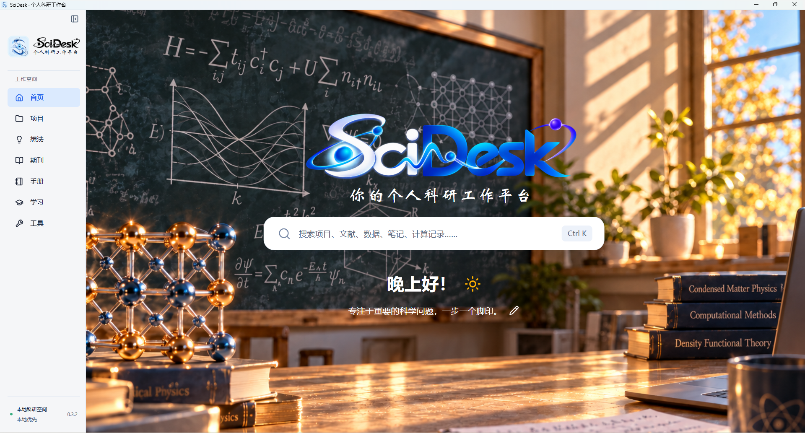
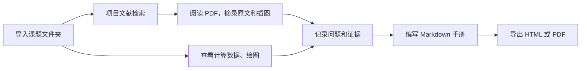
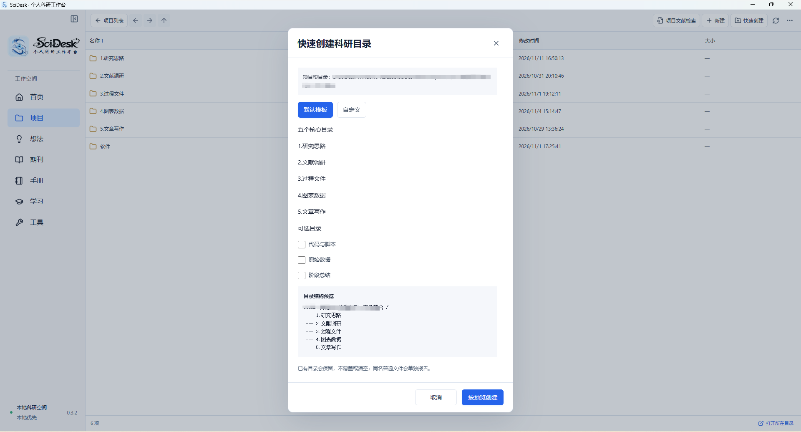
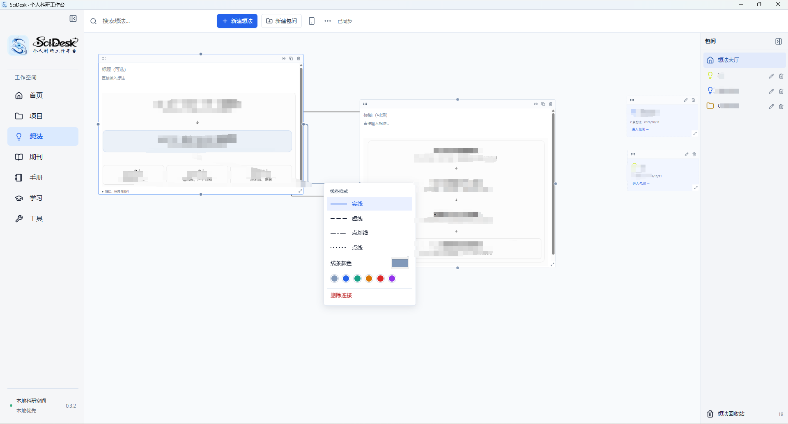

# SciDesk · 个人科研工作台

SciDesk 是一款中文 Windows 桌面软件，把课题文件、论文线索、计算结果和教学笔记放在同一个工作界面中。你可以从磁盘上已有的课题目录开始，查阅相关文献、摘录论文中的图和文字，再把自己的计算步骤整理成一份可以分享的手册。

其实，我最喜欢喜欢工具功能，如果你有经常使用的代码，你可以让ai做成一个界面，然后将他纳入到工具中以便轻易使用。

**当前正式版：0.3.2，适用于 Windows 10/11 x64。** [下载安装包](https://github.com/superbao512-sudo/SciDesk/releases/download/v0.3.2/SciDesk_0.3.2_x64-setup.exe) · [SHA-256 校验文件](https://github.com/superbao512-sudo/SciDesk/releases/download/v0.3.2/SHA256SUMS.txt) · [发布说明](https://github.com/superbao512-sudo/SciDesk/releases/tag/v0.3.2)

## 第一次打开

运行安装包，选择当前账户可写的目录。若电脑缺少 Microsoft Edge WebView2，安装时需要联网。启动后选 **项目 → 导入项目**，指向你平时使用的课题文件夹，即可从文件树打开已有资料。首页支持按 **Ctrl+K** 搜索，也可以点击首页副标题或问候语旁的编辑按钮，写下自己的工作提醒。

## 从一个课题开始

以「某种材料的物性」为例，原始计算放在项目文件夹里，研究假设放在想法画布上，值得复用的步骤写进手册。下面是一条可按需要选用的工作路线。

### 项目、文献检索与想法

| 工作 | 入口与操作 | 得到什么 |
| --- | --- | --- |
| 管理课题文件 | 在「项目」中新建或导入目录。进入文件树后，右击文件或文件夹可复制、重命名，或经确认后移入回收站。 | 整理结果直接反映在磁盘上。试算新参数时，可以先复制一份输入文件。 |
| 检索课题文献 | 在项目文件页点「项目文献检索」，输入材料名和关键词，例如 `phonon scattering`，按期刊、arXiv 来源和年份筛选。 | 打开原始记录核对作者和 DOI，导出 Markdown 阅读清单或 JSON 结果。 |
| 记录研究思路 | 在「想法」中按主题建立房间，在画布上添加节点、附件和连线。 | 例如把「低频模贡献是否下降」连到待检验的假设、对应图表和下一步计算，之后可以回到同一张画布继续。 |

### 期刊：跟踪自己的研究方向

1. **连接学术主页。** 在「我的学术主页」填入自己的 Google Scholar 作者主页链接，核对研究方向和论文列表。若连接失败，可在浏览器展开希望导入的论文，右击网页空白处选「另存为…」，保存为 HTML，再到「更换主页 → 导入主页 HTML」选择主文件。
2. **看长期推荐。** 「为我推荐」根据主页的研究方向获取相关文章。适合持续跟踪自己的课题；获取新文章需要网络。导入的主页 HTML 是保存时的快照，可以重新保存和导入。
3. **查临时主题。** 「自定义关键词检索」适合单独查一个材料或方法，例如 `chiral phonons`。如果关心特定刊物，可到「期刊库」浏览和管理来源，再打开原文。

### 学习：把自己的书签变成分类目录

从 Chrome 书签管理器或 Edge 收藏夹菜单导出书签 HTML，然后打开 **学习 → 导入自己的浏览器书签（HTML）**。原文件夹已经分好类时，可直接选择文件；需要整理时，展开页面内的 AI 分类提示词，将提示词和准备分享的书签交给自己选择的 AI，再导入它返回的书签 HTML。

SciDesk 会先列出识别出的分类和网址数量，确认后才写入学习库，重复网址会跳过。例如，可以把 **Quantum ESPRESSO → 官方文档、入门教程、计算实例** 放在同一主题下，另建 **声子与热输运** 保存相关资料。也可以单独添加网址、编辑分类，或给某条资源关联一份本地备份。

### 手册：从本地文件夹到可分享的教程

「手册」可以关联已有的本地文件夹。要从头写教程，在 **工具 → 教学手册编辑器** 开始写作。左边输入 Markdown，右边直接查看标题、插图和公式的排版效果。

1. 把教程拆成章节，例如「准备输入」「运行计算」「检查结果」。用 `##` 写小节标题；行内公式可以写作 `$E=\hbar\omega$`。
2. 插入计算结果图，保存章节，再点 **编译整本**。在整本预览里检查章节顺序、图片和公式，然后导出 HTML 或 PDF。
3. 搬迁手册时复制整个手册目录及图片。**解除关联**只移除 SciDesk 中的入口；右键**删除**并确认会把所选磁盘文件移到回收站。

## 科研工具怎么用

| 工具 | 适合的任务 | 操作要点 |
| --- | --- | --- |
| PDF 阅读与摘录 | 留下论文中的原文、图和自己的理解 | 打开 PDF，选择文字或框选插图，保存摘录与批注。可使用本地英译中，也可配置联网模型；选用联网服务时，所选文字会发送给该服务。扫描页能否选字取决于 PDF 是否有文字层。 |
| 科研数据快速绘图 | 比较多组计算输出，例如不同温度下的曲线 | 打开表格数据，指定横轴与纵轴的数据列，叠加曲线，核对单位和图例后导出图像。 |
| 曲线数据提取 | 从只有图片的曲线图中取点 | 导入图像，用已知刻度标定横纵轴，核对线性或对数刻度，再沿目标曲线取点并导出数值。 |
| 高级截图 | 给教程截取局部界面或标注计算结果 | 选择区域后添加标注；要边读边对照，可将截图悬浮贴在桌面。工具卡上的设置按钮可调整捕获选项。 |
| 物理单位与公式速查 | 在读论文、整理参数时换算频率、能量或压力 | 按 **Alt+U**，选择物理量和输入、输出单位，输入数值即可换算。 |

### Wannier 能带与 DOS 分析

从 **工具 → Wannier 能带与 DOS 分析** 打开独立分析窗口。只想看费米能附近有哪些轨道贡献时，可以从 PDOS 文件开始；需要检查 Wannier 拟合时，再补充同一计算的结构和能带。

| 要回答的问题 | 在分析窗口怎么做 | 如何读结果 |
| --- | --- | --- |
| 费米能附近哪些轨道占主导？ | 载入 VASP 或 Quantum ESPRESSO 的 DOS/PDOS 数据，检查自旋、元素和轨道；核对能量是否已减去费米能，再选择积分区间，例如 −2 至 +2 eV。 | 点击贡献柱可高亮对应曲线。「参与统计」决定占比的分母，「仅显示」和 Top N 控制图上可见的通道。 |
| 如何选初始投影和能量窗口？ | 从当前 DOS 数据生成投影建议，按提示补充同源结构；分析窗口时再提供 DFT 能带和目标轨道数。 | 结合目标能区与轨道成分检查建议，并保留使用的输入和参数，方便复查。 |
| Wannier 拟合在哪段 k 路径偏差较大？ | 载入 DFT 与 Wannier 能带，先对齐 k 路径、能量单位和参考零点，再查看匹配误差。 | 对照能带曲线与误差报告定位偏差。可导出图像、CSV 和参数 JSON，并从分析历史回看本次记录。 |

## 未来
我希望他能够接入Ai，实际上这是容易实现的，但是可惜在目前版本我不打算考虑，因为开发版本的Ai功能很糟糕。所以我给出以下建议：使用目前主流的ai工具，把这个平台当成一个管理窗口。当然，可以等我加入ai功能。……

## 更新与备份

- **检查更新。** 点击侧栏底部的「检查更新」。发现新正式版后，可从软件打开 GitHub 发布页下载安装包。
- **升级或换电脑。**
- 在同一台电脑升级：关闭 SciDesk 和分析工具，将新版安装到原目录。软件会继续读取已有的 SciDeskData，外部项目和手册也继续使用原路径。升级前备份是一项可选保险，用于防范误删、磁盘故障等意外。
- 换电脑迁移：如果想在新电脑上继续使用原来的资料，就需要复制 SciDeskData。外部关联的课题和手册在各自的文件夹里，也要迁移或确保新电脑能访问；如果路径变了，再重新关联。
- **联系** Ai迅速发展的时代，我只是一个应用ai实现我想法的人，所以您在使用中难免会有问题，我很抱歉，请向我反馈，此外，如果你有好的建议和功能想法也可以向我留言。这是我的邮箱：superbao512@gmail.com  
