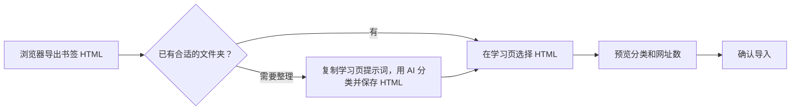
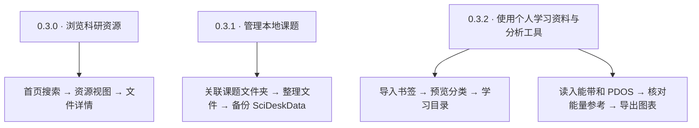

# SciDesk · 个人科研工作台

SciDesk 是面向 Windows 的中文桌面软件。你可以围绕一个课题整理计算文件、检索文献、追踪研究方向，并把计算步骤和结果写成带公式与插图的教学手册。项目和手册使用本地文件夹，可以随时从资源管理器打开。

## 第一次使用

1. 在本仓库的 [Releases](https://github.com/superbao512-sudo/SciDesk/releases) 页面查看已发布版本及其安装包。将 Windows x64 版本安装到当前账户有写入权限的位置。使用便携发行包时，请先完整解压，再运行 `scidesk.exe`。
2. 在左侧选择 **项目 → 导入项目**，选中一个已有的课题文件夹。也可以点 **新建项目**，从空目录开始。打开文件树，核对目录中的计算输入、图表和文稿。
3. 进入 **期刊** 连接自己的 Google Scholar 主页，或进入 **学习** 导入浏览器书签。这两项可以按需要分别设置。

## 选择工作入口

| 我想做什么 | 从哪里开始 | 操作与结果 |
| --- | --- | --- |
| 找到课题文件或查文献 | 项目 | 进入课题后浏览文件树，右击可复制或重命名文件。在「项目文献检索」输入材料名和研究关键词，核对原文后导出 Markdown 或 JSON。 |
| 追踪近期论文 | 期刊 | 「为我推荐」使用学术主页的研究方向。「自定义关键词检索」可临时追踪另一个主题，例如声子热导率。获取新文章需要联网。 |
| 记录研究思路 | 想法 | 在画布上建立主题、笔记和关联，把相关附件放在同一研究问题下。 |
| 编写带公式和插图的教程 | 手册 / 工具 → 教学手册编辑器 | 左侧写 Markdown，右侧看排版。保存各章后点「编译整本」检查章节顺序和插图，再导出 HTML 或 PDF。 |
| 按主题找教程 | 学习 | 导入自己的书签 HTML，然后按主题和用途查找。可以把 VASP 与 Quantum ESPRESSO 分开，并在各自目录下保留官方文档、入门教程和计算实例。 |
| 分析能带或态密度 | 工具 → Wannier 能带与 DOS 分析 | 在独立窗口载入同一计算的能带或 PDOS 文件，确认能量零点，选择积分区间，查看轨道贡献并导出图表。 |

### 学术主页连接失败时

在浏览器打开自己的 Google Scholar **个人主页**，展开要导入的论文，在页面空白处右击「另存为…」，保存为 HTML。回到 SciDesk，选择 **期刊 → 更换主页 → 导入主页 HTML**，选中保存的网页主文件。导入后核对作者和研究方向。以后可以用新保存的网页更新这份资料。

### 把浏览器收藏整理成学习目录

在 Chrome 的书签管理器或 Edge 的收藏夹菜单中选择导出。SciDesk 在本地读取所选 HTML，并在导入时跳过重复网址。如果使用外部 AI，可以只提供准备整理和分享的书签。

## 版本与功能图解

以下按已有开发记录列出三个版本的代表性工作流。可下载版本及对应安装文件以 Releases 页面为准。

| 版本 | 代表性工作流 | 可以完成的任务 |
| --- | --- | --- |
| **0.3.0** | 首页搜索 → 资源集合 → 文件详情 | 以统一视图浏览项目、学习资料、图表和写作资源；在本地检索已收录的内容。 |
| **0.3.1** | 导入本地课题 → 文件树 → 打开或整理文件 | 以本地项目文件夹开展工作。安装版将数据库、默认项目和导出目录集中到程序旁的 `SciDeskData`，方便备份迁移。 |
| **0.3.2** | 书签 HTML → 分类预览 → 学习目录；计算输出 → Wannier 分析 → 图表 | 学习页支持导入自己的书签和 AI 整理后的分类。工具页集成 Wannier 能带与 DOS 分析。学术主页支持 HTML 导入，手册编辑器支持整本预览与导出。 |

## 备份与迁移

关闭 SciDesk 和分析工具后，复制程序旁的整个 `SciDeskData` 文件夹。导入的外部课题和手册仍位于各自的原始路径，需要单独备份。换电脑后，恢复数据并检查这些目录关联。手册的「解除关联」只移除软件中的入口；右键「删除」并确认会将所选磁盘文件移到回收站。
